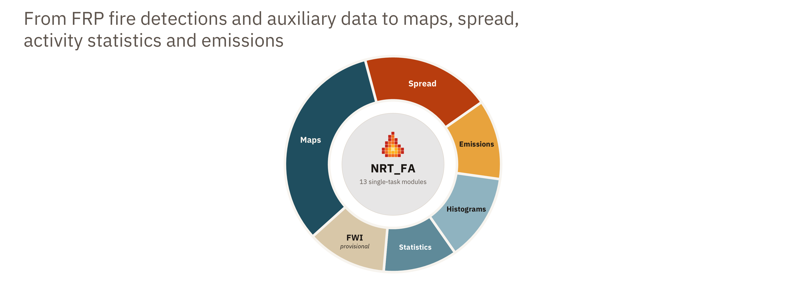
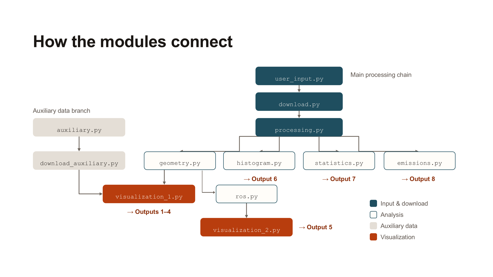
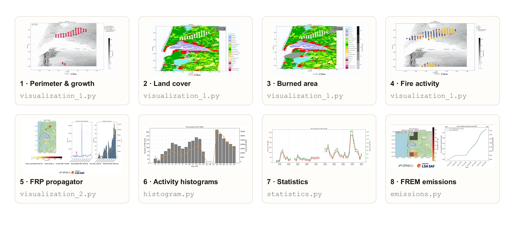

# NRT FA - Near Real-Time Fire Analysis
*Operational tool for fire propagation analysis using Fire Radiative Power (FRP) observations*
---

## Overview

Near Real-Time Fire Analysis is a tool for generating wildfire-monitoring products from Meteosat Third Generation (MTG) Fire Radiative Power (FRP) observations and other products disseminated by EUMETSAT. The tool provides a modular framework in which the user can select the products and analyses to be generated for each fire. It is designed to support operational wildfire monitoring and fire behaviour analysis. The user selects the analysis period, the study area and the outputs to generate. The program then creates fire perimeter, land cover and activity maps, rate-of-spread animations, FRP/FRE statistics and FREM GIFs. The project was developed to provide a simple and operational framework that can be applied to fires in Europe. Developed at IPMA.

For a user-defined geographical region and time period, the workflow automatically:



    
## Contents

- [Before you start](#before-you-start)
- [Run the application](#run-the-application)
- [Information requested – input requisites](#information-requested--input-requisites)
- [Available outputs](#available-outputs)
- [Perimeter reconstruction methods](#perimeter-reconstruction-methods)
- [Where to find the outputs](#where-to-find-the-outputs)
- [Download cache](#download-cache)
- [Important notes](#important-notes)
- [Credits](#credits)
- [License](#license)
- [Appendix A – Python package requirements](#appendix-a--python-package-requirements)

## Before you start

Make sure that:

1. Python is installed, and the required Python packages are available in the environment you will use (see [Appendix A](#appendix-a--python-package-requirements)).
2. You have valid **LSA SAF credentials**, required to download MTG FRP observations and FREM (Fire Radiative Energy eMissions) data: <https://lsa-saf.eumetsat.int/en/data/products/fire-products/>.
3. To access the burned-area data (Output 3), you have an account with the **Copernicus Data Space Ecosystem (CDSE)**. If you do not have one, you can [register here](https://documentation.dataspace.copernicus.eu/Registration.html). To create the API credentials required by the application, follow the [CDSE Authentication Tutorial](https://documentation.dataspace.copernicus.eu/APIs/SentinelHub/Overview/Authentication.html).
4. You have the complete project folder, including the main Python script (`run_main.py`), the `modules/` folder, the required auxiliary data and the image files used in the maps (`IPMA.jpg` and `LSA_SAF.png`). **Keep the original folder structure.**
5. The computer has an internet connection whenever new FRP or FREM data need to be downloaded.

## Run the application

1. Open **Anaconda Prompt** if you use Anaconda; otherwise, open a terminal or Command Prompt.

   > **Tip:** Conda is recommended. Packages such as `cartopy`, `rasterio` and `geopandas` can be difficult to install with pip, especially on Windows.

   **Using Anaconda Prompt**

   Activate your environment (if it is different from the `base` environment):

   ```bash
   conda activate <environment_name>
   ```

   Install the required packages:

   ```bash
   conda install -c conda-forge pandas numpy matplotlib geopandas shapely scipy rasterio h5py pyproj cartopy imageio pillow requests xarray alphashape
   ```

   **Using Command Prompt / terminal (without Anaconda)**

   ```bash
   # Check that Python is installed
   python --version

   # Update pip
   python -m pip install --upgrade pip

   # Install the required packages
   python -m pip install pandas numpy matplotlib geopandas shapely scipy rasterio h5py pyproj cartopy imageio Pillow requests xarray alphashape
   ```


2. Move to the project folder, where the main Python script is located:

   ```bash
   cd path/to/project
   ```

3. Run the main script:

   ```bash
   python run_main.py
   ```

4. Answer the questions displayed by the program. You do not need to edit the code.

## Information requested – input requisites

The program asks for the following information:

1. **Output name:** a name for the fire and its outputs, for example `Bordeaux`.
2. **Start date:** the first date (UTC) to include, in `YYYY-MM-DD` format.
3. **End date:** the last date (UTC) to include, in `YYYY-MM-DD` format.
4. **Study area:** minimum and maximum latitude, followed by minimum and maximum longitude, in decimal degrees. For example: `44.3, 45.0, -1.3, -0.9`.
5. **LSA SAF credentials:** your username and password.
6. **Products:** the numbers of the products you want, separated by commas. For example, `1,4,7` generates perimeter maps, fire activity maps and statistics.
   - **If Output 3 is selected:** you will be asked for your CDSE Client ID and Client Secret (see step 3 of [Before you start](#before-you-start)).
   - **If Output 8 is selected:** you will be prompted to choose a pollutant for the FREM GIF.

> [!IMPORTANT]
> Check the dates and geographical limits before continuing, as these determine which observations are included in the analysis.

## Available outputs

Choose one or more of the following outputs:

| # | Output | Description |
|---|--------|-------------|
| 1 | **Fire perimeter maps** | Fire perimeter with elevation, rivers, populated places and hourly area growth. |
| 2 | **Land cover maps** | Land cover with the reconstructed fire perimeter. |
| 3 | **Land cover and burned area maps** | Land cover, the fire perimeter and historical burned-area information. |
| 4 | **Fire activity maps** | FRP detections grouped into Night, Day and Sunset periods, shown with the fire perimeter and geographical context. |
| 5 | **FRP Propagator GIF** | Animation of fire evolution showing FRP detections, the reconstructed perimeter and Rate of Spread (ROS). Uses the Alpha Shape method to reconstruct the perimeter. |
| 6 | **Fire activity histograms** | Daily histograms showing the number of FRP detections and hourly-accumulated FRP. |
| 7 | **Fire statistics** | Hourly maximum FRP and daily accumulated FRP and Fire Radiative Energy (FRE). Results include tables and CSV files for further use. |
| 8 | **FREM GIF** | Animation for one selected pollutant using FREM data. Available choices: CO, CO2, CH4, N2O, TPM and PM25. Saved in the `emissions` folder. |
| 9 | **ALL** | Generates all products (1–8). For large fires, see the [important notes](#important-notes). |



## Perimeter reconstruction methods

For all products that display a reconstructed fire perimeter, the application uses **Delaunay triangulation** to connect the available FRP detections and estimate the fire's spatial extent. The perimeter is derived from the resulting triangulated geometry.

The exception is **Output 5** (FRP Propagator GIF showing ROS), which uses the **Alpha Shape** method. Alpha Shape estimates a boundary around the FRP detection points and can follow concave outlines of their spatial distribution. As a result, the perimeter shown in this GIF may differ from the perimeter shown in the other outputs.

In both cases, the perimeter is an estimate based on the available FRP detections, not an official burned-area boundary.

## Where to find the outputs

Outputs are saved in the `output` folder, inside a subfolder named after the output name you entered:

```text
output/
└── <fire_name>/
    ├── perimeter/
    ├── landcover/
    ├── landcover_burned_area/
    ├── activity/
    ├── frp_propagator/
    │   └── <fire_name>.gif
    ├── histograms/
    ├── statistics/
    └── emissions/
        └── FREM_<fire_name>_<pollutant>.gif
```

Only the folders corresponding to the selected products are created. Open the relevant folder to view the maps, GIFs, histograms, tables or CSV files.

## Download cache

Previously downloaded FRP and FREM files **are kept locally and reused in later runs**. This avoids downloading the same data again and can make repeated analyses faster.

At the end of a run, the application asks whether you want to clean the cache. Enter `y` to remove cached files, or `n` to keep them. Deleted data may need to be downloaded again.

## Important notes

- **The fire perimeter is an estimate** based on the available FRP detections. It is not an official burned-area boundary. Results also depend on the selected dates and study area, the FRP observations available for that period, and the auxiliary datasets used by the selected outputs.
- **FRP detections are required.** The script checks for FRP detections before generating outputs, so it stops if none are found in the selected area and period — even if only the FREM GIF is selected.
- **Interpreting the emissions GIF:** it should be read as an emissions assessment on a regular 0.1° × 0.1° spatial grid, not as a representation of the fire's actual location, spatial extent or growth. Since FREM data are only calculated when FRP is detected, some fires may have no corresponding emissions data or GIF. The absence of FREM data should not be interpreted as evidence that a fire is producing no emissions; it may instead reflect the inability of the satellite to detect its FRP.
- **Large fires:** it is recommended to generate outputs in separate runs rather than selecting all products at once. Processing a large volume of data simultaneously may overload the cache and lead to errors during execution.

## Credits

Developed at the **Portuguese Institute of Sea and Atmosphere (IPMA)** by Diogo Sousa, Miguel Carvalho, Rita Duarte, Rita Durão and Célia Gouveia.

**Acknowledgements:** EUMETSAT LSA SAF, Copernicus Data Space Ecosystem.

## License

This project is licensed under the [European Union Public Licence v1.2 (EUPL-1.2)](https://interoperable-europe.ec.europa.eu/collection/eupl/eupl-text-eupl-12). See the [LICENSE](LICENSE) file for details.

## Appendix A – Python package requirements

Install the following packages in the same Python environment used to run the application:

| Package | Main use |
|---------|----------|
| `pandas` | Tabular data processing |
| `numpy` | Numerical operations |
| `matplotlib` | Plots and figures |
| `geopandas` | Geospatial vector data |
| `shapely` | Geometries and spatial operations |
| `scipy` | Scientific computing, including triangulation |
| `rasterio` | Raster data |
| `h5py` | HDF5 data access |
| `pyproj` | Coordinate reference systems and reprojection |
| `cartopy` | Map projections and geographic plotting |
| `imageio` | Image and GIF creation |
| `Pillow` | Image processing |
| `requests` | HTTP requests and data downloads |
| `xarray` | NetCDF data access |
| `alphashape` | Fire perimeter computation |

Python standard-library modules used by the application, such as `pathlib`, `datetime` and `importlib`, are included with Python and do not need to be installed separately.

Project-specific modules — `visualization_1.py`, `user_input.py`, `download.py`, `processing.py`, `geometry.py`, `ros.py`, `visualization_2.py`, `auxiliary.py`, `download_auxiliary.py`, `histogram.py`, `statistics.py` and `emissions.py` — are available in the project's `modules/` folder. They are not installed with pip. Keep the complete project folder and its original structure.
